# Implementation Plan: Analysis Pipeline, Agent Prompts & Decision-Support Synthesizer

This plan incorporates the findings from the NVDA analysis review, the audit of all 12 agent prompts and data profiles, and the technical review refinements.

---

## Architecture & Data Flow Overview

```mermaid
flowchart TD
    subgraph SQL["1. PostgreSQL Views (database / company)"]
        VSP["v_share_price_signals\n+ ma_20, ma_50, ma_200\n+ high_52w, low_52w, drawdown_52w_pct\n+ range_position_52w_pct, down_days_high_vol_5d"]
        VTD["v_ticker_document\nSEC 10-K/10-Q/8-K"]
    end

    subgraph FactSheet["2. Fact Sheet & Calculators (analyst)"]
        CFS["CompanyFactSheetData (analyst/dto)\n- Period normalization (Period End Label)\n- Distinct EarningsEstimate citation keys (date + horizon)\n- Strip compositeSignal ('BUY') from citations\n- 8-K recency filter for News (75d)\n- Finnhub relevance filter (COMPANY_DIRECT vs MARKET_CONTEXT)"]
        FMC["ForensicMetricsCalculator (analyst/service)\n- Non-op income % of EBT\n- Total Payout (Buybacks+Div) / FCF\n- Short-term debt delta vs Buybacks\n- Non-capex investing outflows / FCF"]
        VSC["ValuationScenarioCalculator (analyst/service)\n- Shared Forward P/E & EPS reconciliation\n- Implied P/E sensitivity matrix (% vs current close)\n- Reverse DCF vs Forward P/E divergence"]
    end

    subgraph Agents["3. Specialist Agents (existing executionOrder 0..9)"]
        VAL["ValuationAgent (order=3)\nReceives pre-computed Forward P/E & Estimates"]
        EE["EarningsEstimatesAgent (order=8)\nReceives quarterly-vs-annual reconciliation"]
        SPEC["Macro (0), Fundamentals (1), CashFlow (2),\nSharePrice (4), Risk (5), News (6), Insider (7), SmartMoney (9)"]
    end

    subgraph Validation["4. Verification & Synthesis (analyst / ui)"]
        PCV["PreCriticValidationService & CriticAgent\n- isConsistent = no UNRESOLVED && reruns.isEmpty()"]
        SYN["SynthesizerAgent & SynthesizerGuardrailService\n- Exact 1:1 factor_scores mapping\n- Extended calculateTargetConviction (1-5)\n- Deterministic sensitivity scenarios (% moves)\n- Word-boundary compliance check"]
        CV["CitationVerifierService\n- Combined AgentEvidence verification"]
    end

    SQL --> FactSheet --> Agents --> Validation
```

---

## Phase 1: Quick, Independent Fixes (Prompts, Citations, Critic & News)

### 1.1 Fix Earnings Estimates Citation Key Collision
* **File**: `src/main/java/com/oraculum/analyst/dto/CompanyFactSheetData.java`
* **Change**:
  * In `getFutureEarningsEstimates()`, change the unique key passed to `wrapWithCitation` from `company.ticker() + "_" + dto.date()` to `company.ticker() + "_" + dto.date() + "_" + dto.horizon()`.
  * Prevents `fiscal year` (FY27) and `fiscal quarter` (Q4 FY27) estimates sharing `"date": "2027-01-31"` from colliding on citation `[318]` and dropping the Q4 estimate from `CITATIONS`.

### 1.2 Add `source_type` to `AgentEvidence` & Prompt JSON Schemas
* **Files**:
  * `src/main/java/com/oraculum/analyst/agent/dto/AgentEvidence.java`
  * Specialist prompt `.md` files in `src/main/resources/prompt/`
* **Changes**:
  * Add `@JsonProperty("source_type") String sourceType` to `AgentEvidence` so Jackson preserves it for the `Type` column in `src/main/java/com/oraculum/ui/views/components/renderer/AgentDataRenderer.java`.
  * Add `"source_type": "REPORTED | CALCULATED | DERIVED | ESTIMATED"` to the JSON schema block in all specialist prompts.

### 1.3 Fix Critic `is_consistent` Calculation & Normalize Fiscal Period Labels
* **Files**:
  * `src/main/java/com/oraculum/analyst/agent/service/impl/CriticAgent.java`
  * `src/main/java/com/oraculum/analyst/dto/CompanyFactSheetData.java`
* **Changes**:
  * In `CriticAgent.mergeFindings()`, change `boolean consistent = combined.isEmpty() && reruns.isEmpty();` to check that no contradiction has `c.resolution() == Resolution.UNRESOLVED` and `reruns.isEmpty()`. Contradictions with `Resolution.NARRATIVE_RECONCILED` remain visible in the UI with a `RECONCILED` badge without flipping the entire report to `is_consistent: false`.
  * In `CompanyFactSheetData.namespaceJsonMetrics()`, inject `"Period End Label"` (e.g., `"Q2 (ended 2026-07-31)"`) so agents anchor periods by calendar report date.

### 1.4 News Relevance Filter, Multi-Day Coverage & 8-K Recency Window
* **Files**:
  * `src/main/java/com/oraculum/harvester/service/FinnhubNewsService.java`
  * `src/main/java/com/oraculum/analyst/dto/CompanyNewsSlim.java`
  * `src/main/java/com/oraculum/analyst/dto/CompanyFactSheetData.java`
* **Changes**:
  * **Why only ~16 hours of news appeared**: Finnhub returns ~200+ recent items for mega-caps, and `HarvesterLiveApi.fetchCompanyNews(..., limit=50)` truncates to the 50 newest items *before* checking relevance.
  * **Fix**: Classify articles by matching `ticker` (`NVDA`) or normalized company name (`Nvidia` from `NVIDIA CORP`) in `headline` or `summary`:
    * Prioritize `COMPANY_DIRECT` articles before applying the `articleLimit` (`50`), and cap `MARKET_CONTEXT` articles (e.g., max 5) so direct company news from the past 14–30 days isn't crowded out by same-day Yahoo Finance market roundups.
    * Add `String relevance` (`"COMPANY_DIRECT"` vs. `"MARKET_CONTEXT"`) to `CompanyNewsSlim`.
  * **8-K Recency**: In `CompanyFactSheetData`, add `getRecentSecEx991Summaries(LocalDate analysisDate, int maxAgeDays)` (e.g., `75` days) for `NewsAgent`, while keeping the full 1-year `SEC_8K` history for `EarningsEstimatesAgent`.

### 1.5 Optimize Historical Window Sizes (`FinancialDataProfile`)
* **File**: `src/main/java/com/oraculum/analyst/api/domain/FinancialDataProfile.java`
* **Changes**:
  * Change `QUARTERLY` limit in `HISTORICAL_OPERATING` (`FundamentalsAgent`) from `Integer.MAX_VALUE` (20 quarters) to `8` quarters (alongside 5 years of `ANNUAL` statements).
  * Change `TTM` limit in `CURRENT_VALUATION` (`ValuationAgent`) and `BALANCE_SHEET_RISK` (`RiskAgent`) from `Integer.MAX_VALUE` to `8` quarters (alongside 5 years of `ANNUAL` statements).
  * *(Verified: `CompanyFactSheetData` applies `.limit(limit)` before registering citations in `CitationRegistry`, and `DataQualityMetricsCalculator` evaluates completeness on `getLatestRatio(data)` only.)*

### 1.6 Agent Prompt Cleanup
* **`macroeconomic.md`**: Change `previous_value` rule so `value` = `latestValue` + YoY change (e.g., `"4.08% (+87 bps YoY)"`) and `previous_value` = `value1yAgo` (`"3.21%"`), eliminating `"0%"` / `"0 bps"`. Pass `analysis_date`.
* **`fundamentals.md`**: Remove dead field references (`growth_analysis`, `profitability_analysis`, `quality_signals`) and conflicting "one-sentence `summary`" instruction.
* **`valuation.md`**: Remove references to non-existent `monthly_share_price_signals` and `intrinsic_value_assessment`. Add forward valuation inputs.
* **`share_price.md`**: Require `[citation_id]` in `strengths` and `weaknesses`; use SQL-computed `ma_20`, `ma_50`, `ma_200`, `high_52w`, `low_52w`, and `down_days_high_vol_5d`.
* **`risk.md`**: Fix broken list numbering (`1..4, 9..13`) and conflicting summary length instructions; include `sec_mda_summaries` and `forensic_metrics`.
* **`insider_transaction.md` & `AgentDataRenderer.java`**: Align `management_sentiment` and `bullish_conviction` inside `metrics` and update `AgentDataRenderer.java` to read from `metrics` with root fallback.

---

## Phase 2: Data Layer & SQL View Enhancements

### 2.1 Exact Technical & 52-Week Metrics in `v_share_price_signals`
* **Files**:
  * `src/main/resources/db/migration/R__01_base_metrics.sql`
  * `src/main/java/com/oraculum/company/domain/SharePriceSignalEntity.java`
  * `src/main/java/com/oraculum/company/api/dto/SharePriceSignalDto.java`
  * `src/main/java/com/oraculum/analyst/dto/SharePriceSignalSlim.java`
  * `src/main/java/com/oraculum/analyst/dto/CompanyFactSheetData.java`
* **Changes**:
  * In `share_price` CTE (`R__01_base_metrics.sql`), add window calculations:
    * `ma_20` (`ROWS BETWEEN 19 PRECEDING AND CURRENT ROW`), `ma_50`, `ma_200` (rounded to 2 decimals)
    * `pct_from_20d_ma`
    * `high_52w` and `low_52w` (`ROWS BETWEEN 251 PRECEDING AND CURRENT ROW`, consistent with existing `LAG(..., 252)`)
    * `drawdown_52w_pct` and `range_position_52w_pct`
    * `down_days_high_vol_5d` (count of days in last 5 trading rows where `close < close_1d_ago` and `volume > vol_30`)
  * Expose these fields in `SharePriceSignalEntity`, `SharePriceSignalDto`, and `SharePriceSignalSlim`.
  * **Compliance fix**: In `CompanyFactSheetData.processSharePriceSignals`, register `SharePriceSignalSlim` (or a sanitized payload without `compositeSignal`) in `CitationRegistry` so `"compositeSignal": "BUY"` never appears in `CITATIONS`.
  * **Price Date Context**: Include `latestTradeDate` in `CanonicalFacts` and in `DataQualityMetricsCalculator.calculateSharePriceQuality` reason string (e.g., `"Data freshness: 100% (latest close 2026-10-22, 3 days ago)"`) without penalizing SimFin's normal 1-day EOD publication delay.

---

## Phase 3: Forensic, Forward Valuation & Citation Verification Services

### 3.1 `ForensicMetricsCalculator` (Dedicated Service)
* **New Service**: `src/main/java/com/oraculum/analyst/service/ForensicMetricsCalculator.java`
* **Logic**:
  * Extracts forensic and capital-allocation ratios from the latest quarterly and TTM statements (respecting SRP in `AGENTS.md`):
    * `nonOperatingIncomeSharePretaxPctQ`: `Non-Operating Income (Loss) / Pretax Income (Loss) * 100`
    * `shareholderPayoutToFcfRatioPctQ`: `(|Cash from (Repurchase of) Equity| + |Dividends Paid|) / Free Cash Flow * 100`
    * `shortTermDebtDeltaQ`: QoQ change in `Short Term Debt` alongside buybacks
    * `nonCapexInvestingOutflowTtm` & `nonCapexInvestingToFcfRatioPctTtm`: `(|Change in Fixed Assets & Intangibles| - |Net Cash from Investing Activities|)` or sum of `Net Cash from Acquisitions & Divestitures` + `Net Change in Long Term Investment` vs. TTM `Free Cash Flow`.
  * Passed to `FundamentalsAgent`, `CashFlowAgent`, `RiskAgent`, `CriticAgent`, and `SynthesizerAgent` (alongside `sec_mda_summaries` for `CashFlowAgent` and `RiskAgent`).

### 3.2 `ValuationScenarioCalculator` (Shared Forward Valuation & Scenario Matrix)
* **New Service**: `src/main/java/com/oraculum/analyst/service/ValuationScenarioCalculator.java`
* **Logic**:
  * **Keep existing `AgentType` executionOrder unchanged (`VALUATION = 3`, `EARNINGS_ESTIMATES = 8`)**: Instead of reordering agents, `ValuationScenarioCalculator` deterministically computes forward valuation metrics from `EarningsEstimateDto` + `latestClosePrice` and feeds them to **both** `ValuationAgent`, `EarningsEstimatesAgent`, and `SynthesizerAgent`.
  * **Quarterly-vs-Annual EPS Reconciliation**:
    * Sums the 4 quarters matching a fiscal year end date and compares against the full-year consensus EPS (`e.g., sum of Q1–Q4 = 10.07 vs. FY consensus = 9.31`), flagging potential GAAP actual (`SEC_EX99_1`) vs. Non-GAAP consensus mixing.
    * Identifies the **next upcoming quarter** consensus hurdle (`nextQuarterEndDate`, `epsConsensus`, `revenueConsensus`) from existing `EarningsEstimateDto` data (no external earnings calendar API required).
  * **Illustrative Sensitivity Matrix (% Moves vs. Current Price)**:
    * Computes percentage return/move relative to current close across 3 reference forward P/E multiples (e.g., `12x` conservative/stress, `16x` baseline, `20x` optimistic — anchored to peer/historical percentiles) × FY+2 `epsLow`, `epsAvg`, `epsHigh`.
    * Explicitly labeled as an **illustrative sensitivity matrix (not a price target or forecast)** to stay 100% compliant with `synthesizer.md` rules.

### 3.3 Fix False `[?]` on `AgentEvidence` in `CitationVerifierService`
* **File**: `src/main/java/com/oraculum/analyst/service/CitationVerifierService.java`
* **Change**:
  * In `buildVerifiedRecord()`, when `node instanceof AgentEvidence ev`, verify citations in `ev.significance()` against the combined numbers from `ev.value()`, `ev.previousValue()`, and `ev.significance()`, including arithmetic differences (`|value - previousValue|`) when both endpoints are verified in the cited sources.

---

## Phase 4: Synthesizer Guardrails, Scenarios & Compliance-Safe UI

### 4.1 `SynthesizerGuardrailService` & `synthesizer.md`
* **Files**:
  * `src/main/java/com/oraculum/analyst/service/SynthesizerGuardrailService.java`
  * `src/main/resources/prompt/synthesizer.md`
  * `src/main/java/com/oraculum/analyst/api/dto/AnalysisResult.java`
  * `src/main/java/com/oraculum/ui/views/components/renderer/AnalysisOverviewRenderer.java`
* **Changes**:
  1. **Exact 1:1 `factor_scores` Anchoring**:
     * Keep existing map keys (`fundamental_health`, `valuation`, `growth_prospects`, `risk_profile`).
     * Anchor directly to the 4 corresponding specialist scores (`FUNDAMENTALS`, `VALUATION`, `EARNINGS_ESTIMATES`, `RISK`) in `SynthesizerGuardrailService` so `risk_profile` never silently drops from `7.8` to `6.8`.
  2. **Extend Existing `calculateTargetConviction` in `SynthesizerGuardrailService`**:
     * Build on the existing `stdDev` + `unresolved` logic in `SynthesizerGuardrailService.calculateTargetConviction()`:
       * Also cap `conviction` at `3` when valuation lenses diverge (`Reverse DCF == AGGRESSIVE` while `Forward P/E < 25x`) or when `OCF/NI < 0.70` / `FY+2 EPS dispersion > 35%`.
  3. **Deterministic Scenario Ranges in `synthesizer.md`**:
     * Remove the hardcoded `'+30-40%'`, `'+5-15%'`, `'-20-30%'` examples from `synthesizer.md` (lines 76, 81, 86).
     * Pass the pre-computed `ValuationScenarioCalculator` sensitivity table into `SynthesizerAgent` and require `scenarios.bull.implied_upside`, `scenarios.base.implied_move`, and `scenarios.bear.implied_downside` to use the calculated percentage ranges from the sensitivity matrix.
  4. **Word-Boundary Compliance Check**:
     * Add a regex check with word boundaries (`\b`) and compound-word exclusions (preserving `buyback`, `buybacks`, `buy-side`, `sell-off`, `sell-side`, `sell-through`, `oversold`, `overbought`) across all text fields of `AnalysisResult`, logging a warning if imperative advisory phrases (`\b(strong\s+buy|buy\s+now|recommend\s+buying|target\s+price)\b`) appear.
  5. **Backward-Compatible Decision-Support Context**:
     * Keep all new fields in `AnalysisResult` optional/nullable (`@JsonIgnoreProperties(ignoreUnknown = true)`) so existing stored JSONB analyses deserialize without error, and guard `AnalysisOverviewRenderer` against `null`.

---

## Phase 5: Verification & Testing
* **Unit Tests**:
  * `ValuationScenarioCalculatorTest`: Verify forward P/E math, quarterly-vs-annual EPS sum warning, and FY+2 sensitivity matrix percentages (`12x`, `16x`, `20x` × `12.85 / 15.91 / 18.75` at `212.21` -> `-27%` to `+77%`).
  * `ForensicMetricsCalculatorTest`: Verify non-operating income share of EBT, shareholder payout to FCF ratio, and non-capex investing outflows.
  * `SynthesizerGuardrailServiceTest`: Verify 1:1 `factor_scores` enforcement, extended `calculateTargetConviction`, and word-boundary compliance regex (ensuring `"buybacks"` and `"sell-through"` are untouched).
  * `CitationVerifierServiceTest`: Verify combined `AgentEvidence` (`value` + `previousValue` + `significance` + delta) citation verification.
  * `CriticAgentTest`: Verify `isConsistent == true` when all contradictions are `NARRATIVE_RECONCILED`.
* **Architecture Test**:
  * Run existing Spring Modulith verification test (`ApplicationModules.verify()`) to ensure module boundaries remain clean.
